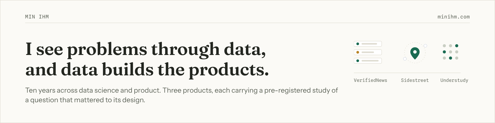
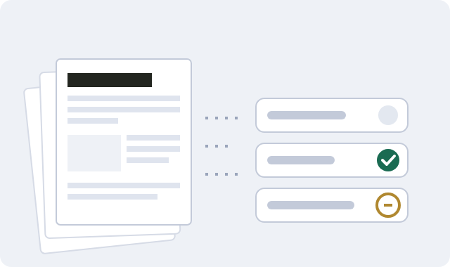
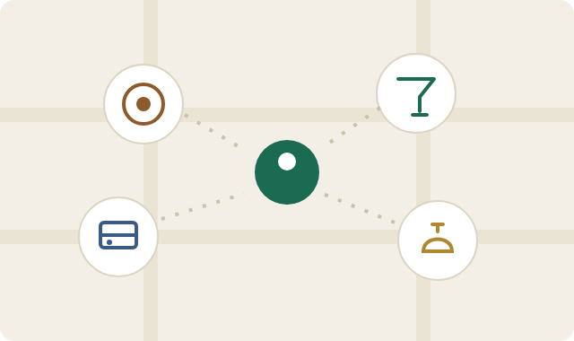
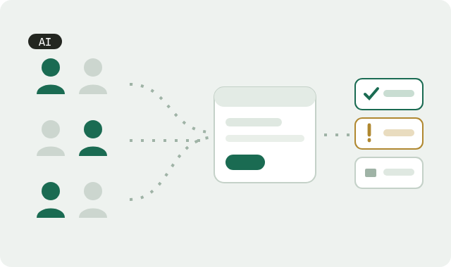

Ten years across data science and product: enterprise data at Autodesk, six years at 6sense with enterprise accounts, now data scientist and head of data product and strategy at Pristine Data AI. I build the products below outside that work, and each one carries a pre-registered study of a question that mattered to its design.

**The portfolio: [minihm.com](https://minihm.com)** holds the studies in full: the questions, the measured answers, the decisions they fed, and how to check every number.

## Products

<table>
<tr>
<td width="36%"></td>
<td>

**VerifiedNews.** A news pipeline that assigns each extracted claim a verification tier, keeping the strength of the evidence separate from how well the claim was reported.
Its study re-checked 600 week-one verdicts against later cited evidence: 23.9% of Contested verdicts held up, so about 3 in 4 doubted claims were true, and the product's rules changed because of it. [Read the study](https://minihm.com/studies/verifiednews-reverification/)

</td>
</tr>
<tr>
<td width="36%"></td>
<td>

**Sidestreet.** Local discovery for people past the touristy layer, from a layered retrieval engine that reads intent from a plain question.
Its study priced every layer of the engine in a 9-arm ablation: the strict filter stayed off, and query interpretation turned out to carry more than any mechanism downstream of it. [Read the study](https://minihm.com/studies/sidestreet-ablation/)

</td>
</tr>
<tr>
<td width="36%"></td>
<td>

**Understudy.** Synthetic user populations that browse a real web app and turn what they do into findings: rage clicks, confusion, pages nobody can find.
Its study seeded 5 known defects at controlled doses and drew the instrument's trust boundary: element-level detections earn trust, page-level signals on their own do not. [Read the study](https://minihm.com/studies/understudy-detection/)

</td>
</tr>
</table>

## The study repositories

Each study lives in its own repository: the design frozen in git before results existed, the data, the analysis, and a verifier that recomputes published numbers from source.

| Repository | What it holds |
|---|---|
| `verifiednews-rescoring-study` | Frozen design, 600-claim sample, re-scoring pipeline and verifier |
| `sidestreet-ablation-study` | 9 arms, stability gates, and the cost of every retrieval layer |
| `understudy-detection-study` | Seeded defects, synthetic populations, detection boundaries |
| `portfolio-site` | The site itself: content as typed collections, gates that fail bad builds |

The repositories are private until each study's release review completes; they open one by one, and the site's references become links when they do.

## Writing

[The System Is the Easy Part: Building Lookalike Modeling Under Real Constraints](https://minihm.substack.com/p/the-system-is-the-easy-part-building)
Notes from building B2B lookalike modeling without a warehouse: the architecture, the constraints, and why novelty comes from data layers.

## Contact

Reach me at min.ihm626@gmail.com or on [LinkedIn](https://www.linkedin.com/in/min-ihm). SF Bay Area.
